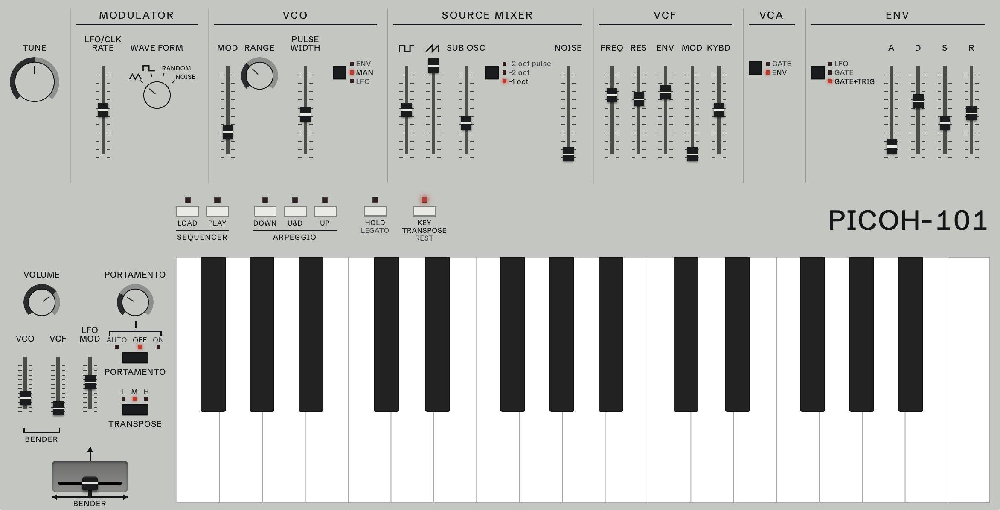

# PICOH-101

<picture>
  <source media="(prefers-color-scheme: dark)" srcset="docs/images/panel-dark.png">
  
</picture>

A monosynth inspired by the Roland SH-101, running on a Raspberry Pi Pico (2 W).

The same code also runs as a CLAP plugin / WCLAP plugin, so you can play it without the hardware.

## Features

- The SH-101's basic architecture: one VCO (saw, pulse with PWM, sub oscillator, noise), a 24 dB ladder filter that self-oscillates, one ADSR, the LFO (triangle, square, random, noise), portamento (AUTO, ON, OFF) and the bender
- Its playing: lowest- or last-note priority by ENV TRIG, the arpeggio (UP, U&D, DOWN), HOLD and KEY TRANSPOSE
- The 100-step sequencer, loaded a key at a time with rests and ties, kept through power off
- The Pico saves its settings, kept through power off

## Hardware

A Raspberry Pi Pico 2 W and a PCM5102A DAC board (SCK to ground, power from the Pico's 3V3):

| Pico | To |
| --- | --- |
| GP19 | DAC BCK |
| GP20 | DAC LRCK |
| GP21 | DAC DIN |
| GP9 | DIN MIDI in, through a 6N138 or H11L1 optocoupler (optional) |

A Pico 2 without the Wi-Fi chip works too, over USB only.

## Try it

From [Releases](../../releases):

- `PICOH-101-pico2_w.uf2`: the firmware. `PICOH-101-pico2.uf2` is for a Pico 2 without the radio.
- `PICOH-101-CLAP-macOS.zip`, `-Windows.zip`, `-Linux.zip`: the CLAP plugin. It isn't notarized, so on a Mac run `xattr -dr com.apple.quarantine PICOH-101.clap` after unzipping.
- `PICOH-101.wclap.tar.gz`: the plugin for (browser) DAWs that load WCLAPs.

## Control

- **Over Wi-Fi:** join the Pico's network `picoh-101` (password `picosynth`) and open http://192.168.4.1/, or http://picoh-101.local/ if it joined yours.
- **Over USB,** from a clone of this repo: run `npm ci && npm run build` in `web/`, then `tools/serve.py`, open http://127.0.0.1:8460/ in Chrome, and choose **USB serial** or **USB MIDI**.
- **In the Tauri iOS/macOS app,** if you built it: it finds the Pico on the cable, or else on Wi-Fi.
- **As a plugin:** load the CLAP in your DAW; its window is the same GUI.

## Build

Clone with `--recursive` to get the [Compost](https://github.com/charCulbert/compost) submodule. The builds need CMake, Python 3 and Node; the firmware fetches its own Pico SDK and toolchain.

**The Pico:** with [picotool](https://github.com/raspberrypi/picotool) installed (`brew install picotool`), hold BOOTSEL while plugging it in the first time, then from `firmware/`:

```sh
cmake -B build && cmake --build build --target flash
```

After that, `--target flash` reboots it into its bootloader by itself (the flash script is macOS-only; elsewhere, copy `build/synth.uf2` onto the drive). To have it join your network instead of making its own, configure with `-DWIFI_SSID=... -DWIFI_PASSWORD=...`. For a Pico 2 without the radio, add `-DPICO_BOARD=pico2`.

**The plugin:** `cd synth && cmake -B build && cmake --build build` makes `PICOH-101.clap`; `tools/build-wclap` makes the WCLAP (needs [WASI SDK](https://github.com/WebAssembly/wasi-sdk) 33 and Ninja).

**The app** (optional, not in Releases): a native shell for the panel, for iPhone where browsers can't reach USB. `cd app && npm install && npx tauri ios build`, or `cargo run` on a Mac. You need Rust, Xcode and your own Apple dev team in `app/tauri.conf.json`.

Opened in VS Code, the folder's tasks do all of this.

## License

MIT. See [LICENSE](LICENSE). Third-party parts keep their own licenses: [THIRD_PARTY_NOTICES.md](THIRD_PARTY_NOTICES.md).
